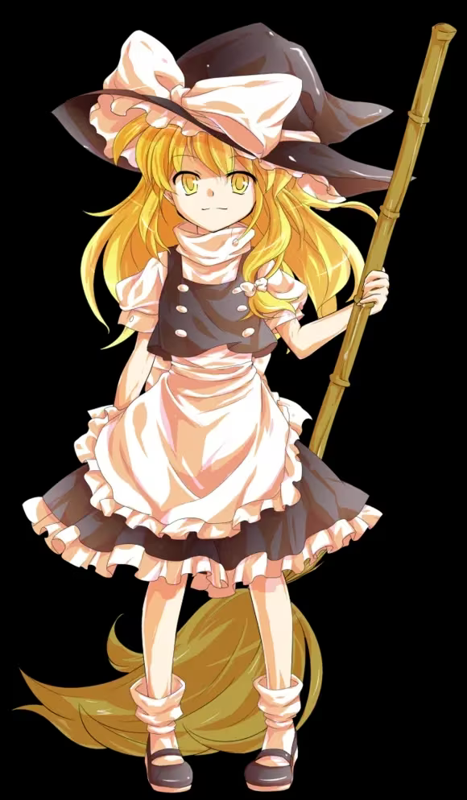

# 魔理沙幸存者 · UI 与手机适配改造方案

> 交给执行 AI（DeepSeek）的实施说明。目标文件只有两个：
> - `marisa_survivor.html`（306 行，DOM + CSS）
> - `js/marisa-survivor.js`（3764 行，全部游戏逻辑）
>
> **硬性约束：** 纯原生 JS（现有代码是 ES5 风格：`var`、`function(){}`），不引入任何框架/构建工具/CDN 依赖；不改任何游戏数值、流程与存档逻辑；所有行号仅供参考，**定位一律以标识符搜索为准**（行号会漂移）。

---

## 0. 问题清单与根因（已实测确认）

| # | 现象 | 根因 |
|---|------|------|
| 1 | 手机横屏游戏画面显示不全，血条压住画面顶部 | 血条/HUD/Boss条/暂停键全是 **DOM 绝对定位**，锚在 `.canvas-wrap` 上；而 canvas 是 16:9 letterbox 居中。DOM 坐标系和 canvas 坐标系互不感知 → 血条横跨全屏（比画面还宽）、压掉画面顶部约 70 逻辑像素，HUD 文字飘在画面外的黑边上 |
| 2 | 强制横屏后选角页"选择自机"标题和"确认"按钮被裁掉看不见 | `.overlay` 是 `justify-content:center` + `overflow-y:auto`：内容超高时 flex 居中导致**上下两端同时溢出被裁**，按钮在最底部够不到 |
| 3 | 开始页简陋 | 纯文字堆叠；游戏未开始时 DOM HUD（满血条 + 000000 分数）裸露在开始页顶上，很出戏；立绘素材没用上 |
| 4 | 暂停菜单冗杂 | `renderPauseStats()` 把 面板数值/12格武器矩阵/强化/遗物/超进化 五大块全部平铺进一个滚动区，小屏上挤压变形，"继续"按钮泡在数据流里 |
| 5 | 桌面 canvas 只有 960×540 一小块 | canvas CSS `width:auto;height:auto` **只缩不放**；固有分辨率固定 960×540 |
| 6 | 触屏笔记本常驻虚拟摇杆 | `isTouch = ('ontouchstart' in window) || navigator.maxTouchPoints > 0` 判定过宽 |
| 7 | 竖屏引导遮罩的 🔄 emoji 在 iOS 渲染成蓝色系统图标 | emoji 跟随系统样式，与暗紫金主题冲突 |
| 8 | iOS 地址栏导致高度计算偏差 | `body/game-container` 用 `100vh` |

---

## 1. 总体设计决策（先读完再动手）

### 1.1 坐标系统一原则（本方案的地基）

游戏内部逻辑坐标**永远是 960×540**（`var W = 960, H = 540`，js 第 9 行）。所有刷怪、走位、摇杆、相机逻辑都建立在这套坐标上，**一行都不用改**。要做的是让"显示"适配：

```
CSS 尺寸 s = min(容器宽/960, 容器高/540)，上限 2.0（防 4K 过大）
背板倍率 k = min(2.5, s × devicePixelRatio)
canvas.width = 960×k, canvas.height = 540×k   ← 物理像素 1:1，清晰
ctx.setTransform(k, 0, 0, k, 0, 0)             ← 绘制代码零改动，自动整体缩放
```

### 1.2 UI 分三类处理（明确分工，不要混用）

| 类别 | 成员 | 策略 |
|------|------|------|
| **数据 HUD**（每帧变、要求精准对齐） | HP 条、XP 条、Lv、计时/击杀/分数、Boss 符卡条 | **canvas 内绘制**（和现有虚拟摇杆同思路），随画面等比缩放，永不出画 |
| **装饰性浮层**（偶发、有滑入动画/CSS 特效） | 符卡宣告 `#spellCard`、Boss 入场横幅 `#bossBanner` | DOM 保留，但挪进 `.stage-ui`（960×540 逻辑盒 + `transform:scale(s)`），现有 CSS 特效原样保留 |
| **全屏菜单** | 开始/选角/暂停/升级三选一/遗物/教程/结算 各 `.overlay` | 仍铺满 `.canvas-wrap`（覆盖黑边没关系，菜单本来就该全屏），只做布局加固 + 内容重排 |
| **交互按钮** | `#pauseBtn` | DOM 保留，锚在 stage 右上角，**物理尺寸恒定**（手指友好），不参与缩放 |

### 1.3 新增 DOM 骨架

```html
<div class="canvas-wrap">
  <div class="stage" id="stage">          <!-- JS 设定 width/height，恰好等于画布 CSS 尺寸 -->
    <canvas id="game"></canvas>
    <div class="stage-ui">                 <!-- 960×540 逻辑盒，transform:scale(s)，装装饰浮层 -->
      <div id="spellCard">…原样搬入…</div>
      <div id="bossBanner"></div>
    </div>
    <button id="pauseBtn">⏸</button>       <!-- stage 右上角，恒定 38px -->
  </div>
  <!-- 删除：.hud、.bars、#bossBar（数据全部入画） -->
  <!-- 所有 .overlay 仍留在 .canvas-wrap 下，成为 .stage 的兄弟节点 -->
  <div class="overlay hide" id="startOverlay">…</div>
  …其余 overlay 不动…
  <div id="rotateOverlay">…</div>
</div>
```

CSS 关键改动：

```css
.stage{position:relative;flex:none;}  /* 尺寸由 JS fitStage() 设置 */
.stage canvas{display:block;width:100%;height:100%;border:1px solid #3a3045;border-radius:12px;
  /* 删掉旧的 aspect-ratio / max-width / max-height / width:auto / height:auto */}
/* 删掉 image-rendering:pixelated / crisp-edges —— 素材是手绘风不是像素风，
   且背板已按 devicePixelRatio 1:1 匹配，pixelated 反而在运动时产生抖动 */
.stage-ui{position:absolute;left:0;top:0;width:960px;height:540px;
  transform-origin:0 0;pointer-events:none;}  /* JS 设置 transform:scale(s) */
```

---

## 2. Workstream A：画面自适应 + HUD 入画（核心，先做）

### A1. `fitStage()` 缩放函数（js 新增，放在 W/H 定义之后）

```js
var stageEl, stageUiEl, STAGE_S = 1;
function fitStage() {
  var wrap = document.querySelector('.canvas-wrap');
  var aw = wrap.clientWidth, ah = wrap.clientHeight;
  if (!aw || !ah) return;
  var s = Math.min(aw / 960, ah / 540);
  if (s > 2) s = 2;                       // 桌面封顶 2 倍
  STAGE_S = s;
  stageEl.style.width  = Math.round(960 * s) + 'px';
  stageEl.style.height = Math.round(540 * s) + 'px';
  stageUiEl.style.transform = 'scale(' + s + ')';
  var k = Math.min(2.5, s * (window.devicePixelRatio || 1));
  cv.width = Math.round(960 * k);
  cv.height = Math.round(540 * k);
  ctx.setTransform(k, 0, 0, k, 0, 0);      // 设置 .width 会重置状态，必须重设
  ctx.imageSmoothingEnabled = true;
}
window.addEventListener('resize', fitStage);
window.addEventListener('orientationchange', fitStage);
// 初始化时（preloadAll 的 then 里、gameLoop() 前）调用一次 fitStage();
```

注意：
- 现有 `updateRotateOverlay`（约 512 行）已监听 resize/orientationchange，两者并存即可。
- `toCanvas()`（约 470 行）用 `getBoundingClientRect` 换算，天然兼容新尺寸，**不要动**。
- 摇杆 `JOY = {x:105, y:H-105, r:62}` 是逻辑坐标，**不要动**。

### A2. 数据 HUD 全部入画

**删除 DOM**：`.hud`、`.bars`（含 `#hpBar/#hpFill/#hpText/#xpFill/#hudLevel/#hudTime/#hudKills/#hudScore/#hudBest`）、`#bossBar`（含 `#bossName/#bossCard/#bossFill`）。删除前先 `grep` 每个 id 在 js 里的全部引用，逐一处理。

**js 改造**：
- 删除 `updateHud()`（约 3303 行）及其 3 处调用（约 2446、3356、3576 行）。
- `hideBossBar()`（约 699 行，被 1175/3337/3363 调用）改为空函数体——保留函数名，免改调用点。其余对 `bossBar` 的 `classList` 操作（`grep 'bossBar'`）全部删除或注释。
- 新增 `drawHUD()`，在 `draw()` 末尾（摇杆绘制之后、受伤红闪之前）调用。

**`drawHUD()` 布局规格**（逻辑坐标，全部用 `ctx.strokeText` 黑描边 + `fillText` 保证在任意背景上可读——这是"融入场景"而不是加面板底板）：

| 元素 | 位置与尺寸 | 样式 |
|------|-----------|------|
| HP 条 | (16, 14) 起，200×13，圆角 6 | 底 `rgba(0,0,0,.55)`；填充 `#ef4444→#f0c060` 线性渐变（宽 = hp/maxHp×100%）；条内居中白字 9px `97 / 140`；血量 <30% 时加红色 `shadowBlur` 呼吸脉冲（用 `frameCount` 算正弦，替代原 `.low` CSS 动画） |
| XP 条 | (16, 32) 起，200×5，圆角 2.5 | 底 `rgba(58,48,69,.55)`；填充 `#8fd8ff→#b89fff` 渐变 |
| Lv 徽章 | (224, 15) 左对齐 | 11px 金色 `#8fd8ff`，粗体 "Lv 7" |
| 计分块 | 右上角 (944, 14) 右对齐 | 行1：`(boss存活?'⚔ ':'⏱ ') + mm:ss + '  💀' + kills`，13px `#e0d8ec` 粗体；行2 (y≈32)：六位分数 + ' HI ' + 最高分，10px `#8a7e9a`。分数用 `String(score).padStart(6,'0')`（沿用原逻辑，最高分来自 `bestScore` 变量，`loadBest()` 已有） |
| Boss 符卡条 | 顶部居中，宽 `min(560, W-360)`，y=14 起 | 三行：Boss 名（红 12px 粗体，`#ef4444`）→ 符卡名+阶段点+倒计时+狂化（11px `#ffb2b2`，数据结构同原 `updateHud` 内 boss 段：`def.cards[boss.cardIdx]`、`boss.thresholds`、`boss.cardT`、`boss.rageStacks`）→ 血条 10×圆角5（底黑，填充 `#7f1d1d→#ef4444`）。只在 `boss && !boss.dead` 时绘制，替代原 `#bossBar` 的 show/hide 逻辑 |

**HUD 显隐门控**（解决问题 3 的"满血条挂在开始页"）：

```js
function drawHUD() {
  var inGame = (gameState === 'playing' || gameState === 'paused'
             || gameState === 'levelup' || gameState === 'relic');
  if (!inGame) return;
  // …按上表绘制…
}
```

`gameState` 的枚举值以 js 实际为准（grep `gameState =`），把所有"局内"状态加进去，开始/选角/结算/教程状态一律不画。

**Boss 条数据源**：原 `updateHud()` 里 boss 段（约 3308–3317 行）的计算逻辑（阶段血量区间、阶段点 `✕●○`、倒计时取整）原样搬进 `drawHUD()`，只是从"写 DOM"变成"ctx 绘制"。

### A3. 暂停按钮

`#pauseBtn` 从 `.canvas-wrap` 挪进 `.stage`，CSS 改为：

```css
#pauseBtn{position:absolute;top:10px;right:10px;z-index:7; /* 尺寸样式保持 38px 一套 */}
```

物理尺寸恒定不缩放（触屏好按）；canvas 计分块从 y=14 起且右对齐 x=944，与 38px 按钮（约占右上角 10~50 逻辑带）在 s≥0.6 时视觉上分层——按钮在角上、文字块在其下方，若实测重叠，把计分块整体下移到 y=58 起。

### A4. 竖屏引导遮罩（rotateOverlay）修缮

逻辑（约 508–527 行 + `#roSkip`）全部保留，只做视觉替换：
- `🔄` emoji 换成内联 SVG：手机圆角矩形轮廓（`#b89fff` 描边）+ 环形箭头（`#f0c060`），自带原 `rospin` 旋转动画（把 keyframes 从 emoji 迁到 SVG 容器上）。
- 主文案"请旋转手机，横屏游玩体验最佳"保持；副文案保持。
- `position:fixed; inset:0; z-index:99` 不动。

---

## 3. Workstream C：选角页与所有 overlay 的"短屏加固"（第二优先）

### C1. 通用加固：`margin:auto` 包裹模式（解决"被裁掉看不到"的系统性修法）

当前 `.overlay`（`justify-content:center`）在内容超高时会上下同时溢出、底部的按钮永远滚不到。修法——**每个 overlay 内容包一层**：

```css
.overlay{justify-content:flex-start;}          /* 移除垂直居中 */
.ov-inner{margin:auto 0;width:100%;display:flex;flex-direction:column;align-items:center;}
```

```html
<div class="overlay hide" id="selectOverlay">
  <div class="ov-inner"> …全部原内容… </div>
</div>
```

原理：flex 列中 `margin-top:auto; margin-bottom:auto` 在空间够时自动居中；空间不够时 margin 归零、从顶部开始、`overflow-y:auto` 可滚——**按钮永远可达**。对 `#startOverlay`、`#tutOverlay`、`#selectOverlay`、`#pauseOverlay`、`#levelOverlay`、`#relicOverlay`、结算 overlay 全部适用。

### C2. 选角页专项（横屏 ≤480px 高）

- 把两张立绘的内联 `style="width:170px"` 移除，改由 CSS 控制：`.sel-card img{width:clamp(96px, 20vh, 170px);}`，横屏自动缩小。
- 短屏媒体查询：

```css
@media (max-height:480px){
  #selectOverlay h1{font-size:18px;margin-bottom:4px;}
  .sel-container{gap:14px;margin-bottom:8px;}
  .sel-name{font-size:12px;} .sel-desc{font-size:10px;}
  .sel-hint{display:none;}
  #selectOverlay .btn-start{font-size:14px;padding:9px 36px;}
}
```

- 顺带给升级三选一同样加短屏规则（`#levelOverlay` 横屏 844×390 下三张 180px 卡 + 标题 + 重抽按钮同样紧张）：

```css
@media (max-height:480px){
  .overlay h1{font-size:20px;} .overlay p{font-size:11px;margin-bottom:8px;}
  .lv-card{width:150px;padding:10px 8px;} .lv-icon{font-size:26px;}
  .btn-reroll{margin-top:6px;padding:7px 20px;}
}
```

- `window._selChar` / 滑动切换 / 键盘 ←→ Enter 逻辑全部不动。

**验收**：844×390 与 667×375 下，标题、两张立绘、确认按钮、滑动提示全部完整可见；390×844 竖屏也完整。

---

## 4. Workstream D：暂停面板 Tab 化（第三优先）

### D1. DOM 重构

```html
<div class="overlay hide" id="pauseOverlay">
  <div class="ov-inner pause-box">
    <div class="pz-head">
      <h1>⏸ 暂停</h1>
      <div class="pz-sum" id="pauseSum"></div>   <!-- 一行摘要 chips -->
    </div>
    <div class="pz-tabs" id="pauseTabs">
      <button class="pz-tab on" data-t="panel">面板</button>
      <button class="pz-tab" data-t="wpn">武器</button>
      <button class="pz-tab" data-t="enh">强化</button>
      <button class="pz-tab" data-t="relic">遗物 · 进化</button>
    </div>
    <div class="pz-body" id="pauseStats"></div>   <!-- 复用原 .ps-* 样式 -->
    <div class="pz-foot">
      <button class="btn-start" id="btnResume">▶ 继续</button>
      <button class="lb-btn-ghost" id="btnRestart">↻ 重新开始</button>
    </div>
  </div>
</div>
```

### D2. JS 重构（在原 `renderPauseStats` 约 1962–2031 行基础上拆分）

- `renderPauseStats()` → 改名 `renderPauseTab(tab)`，原来拼 5 大块的 html 拆成 4 个小函数各返回字符串：
  - `pauseSumHTML()`：`⏱ mm:ss · Lv n · 💀 kills · 分数`（金色 chips，一行）
  - `panelTabHTML()`：原"当前面板"12 格 `.ps-grid`
  - `wpnTabHTML()`：原"武器矩阵"12 格 `.ps-matrix`
  - `enhTabHTML()`：原"强化"8 行 `.ps-row`
  - `relicTabHTML()`：原"遗物" + "超进化进度"两节合并
- 新增 tab 状态：`var pauseTab = 'panel';`，`#pauseTabs` 事件委托切换并重渲染 `#pauseStats`。
- 记住上次所在 tab（本局内），下次暂停默认还停在那。
- `#btnRestart` → `onclick` 调 `startGame()`（约 3327 行：该函数已完整重置状态并在 3339 行隐藏暂停层，直接复用即可）。为防误触，可在按钮上用双击确认或第一次点变成"再点一次确认"文案，二选一。
- 样式新增：`.pz-tabs`（横向一排 pill，窄屏 `overflow-x:auto`）、`.pz-tab.on` 金色高亮、`.pz-body{width:100%;max-width:680px;max-height:52vh;overflow-y:auto;}`、`.pz-foot` 两按钮并排。**底部按钮放在滚动区外**（固定可达）。

**验收**：844×390 横屏下暂停 → 摘要 + 4 个 tab 一屏可见、无滚动挤压；"面板" tab 的 12 格数据一屏放下；继续/重开永远可见可点。

---

## 5. Workstream B：开始页重做（第四优先，设计自由度最大）

### B1. 目标氛围

暗紫夜空 + 金色魔导氛围。canvas 已有免费氛围可利用：`drawMagicCircle` 在 `gameState` 为 start/select/over 时持续动画（约 3292–3295 行），overlay 背景保持半透明（`rgba(26,21,32,.78)` 或改径向渐变 `.72→.86`）让魔法阵透出来。

### B2. 结构与视觉规格

```html
<div class="overlay hide" id="startOverlay">
  <div class="ov-inner start-wrap">
    <div class="start-main">                <!-- 横屏/桌面双栏；竖屏单列 -->
      <div class="start-copy">              <!-- 左栏 -->
        <div class="start-logo">魔理沙幸存者</div>
        <div class="start-sub">MARISA SURVIVORS · 東方弹幕生存</div>
        <div class="start-chips">
          <span>✨ 灵系 · 稳定强化</span><span>🌑 魔系 · 爆发异常</span>
          <span>12 格武器矩阵</span><span>Boss 符卡战</span>
        </div>
        <button class="btn-start" onclick="showSelect()">✦ 出发</button>
        <div class="start-links">
          <button onclick="window._openTutorial(true)">📖 教程</button>
          <button id="lbToggle2">📊 排行榜</button>
          <span class="qq-chip" id="qqChip">🐧 QQ群 702973928</span>
        </div>
      </div>
      <div class="start-art">               <!-- 右栏：魔理沙立绘 -->
        
      </div>
    </div>
    <div class="announce" id="announceBox">  <!-- 保留原折叠公告，压成一行小药丸 -->
      …原 announce-head / announce-body 结构不动…
    </div>
  </div>
</div>
```

视觉要求：
- `start-logo`：clamp(34px, 6vw, 52px)，金色 `#f0c060`，letter-spacing 6px，沿用现有 `titleGlow` 呼吸光晕 keyframes。
- 立绘 `start-art img`：`max-height:min(52vh, 420px)`，上下浮动动画（`translateY ±6px`，3s 循环）+ `drop-shadow(0 0 24px rgba(240,192,96,.25))`；入场从右侧滑入。
- `start-copy` 子元素 stagger 入场：`animation:fadeUp .5s both; animation-delay: calc(var(--i) * 80ms)`，每个子元素设 `style="--i:0/1/2..."`。
- 公告：保留 `window._toggleAnnounce` 逻辑，头部样式改为一行小药丸（12px，金边圆角，默认折叠）。
- QQ 群：白底大图块 → 12px 文字 chip，点击 chip 才弹出小暗色卡片（圆角 12px、深底金边、QR 图 72px）。原 `#qqOverlay` 的 img 引用保留。
- 排行榜 `#lbArea`：保留现有提交/加载逻辑（`grep lbArea / lbToggle`），入口收敛到 `start-links` 的按钮里，展开/收起。
- `@media (max-width:640px)`：单列，立绘移到文案下方、`max-height:26vh`，logo 缩到 clamp(28px,8vw,40px)。
- `@media (max-height:480px)`：立绘 `max-height:34vh`，chips 允许换行。

**所有 `window.*` 导出与 `onclick` 引用不得断**：`showSelect`、`_toggleAnnounce`、`_openTutorial`、`_tutNav`、`_tutSkip`、`_rerollCards`、`_selChar`、`confirmSelect`。

### B3. 加载页（顺手）

`#loadingOverlay` 的"🧹 加载中..."加一个 CSS 旋转的五角星/魔法阵 spinner（纯 border 或 SVG），替代静态文字单调感。低优先。

---

## 6. Workstream E：细节修缮清单（穿插在各阶段做）

1. **视口高度**：`body{height:100vh}` → 双写 `height:100vh;height:100dvh;`；`.game-container{height:calc(100vh - 48px)}` → 同样双写 dvh 版本。
2. **触屏判定**（js 约 468 行）：
   ```js
   var isTouch = !!(window.matchMedia && (window.matchMedia('(pointer: coarse)').matches ||
     (navigator.maxTouchPoints > 0 && window.matchMedia('(hover: none)').matches)));
   ```
   修完触屏笔记本不再常驻摇杆。
3. **viewport meta**：`content` 里追加 `viewport-fit=cover`，并给 `.game-container` 加 `padding-left/right: env(safe-area-inset-left/right)`——iPhone 横屏刘海不再压画面。
4. `images/sprites/mon_boar.png` 目前 404（服务日志确认），代码用 `ldOpt` 容错可暂不管；有素材就补文件。
5. 其余一律不动：BGM、音效、`localStorage` key（`ms_best`/`ms_besttime`/`ms_tut_done`/`ms_ro_skip`）、排行榜 API、`window.__ms` 调试钩子、游戏数值。

---

## 7. 实施顺序（建议按此提交，每阶段独立可验证）

| 阶段 | 内容 | 验证方式 |
|------|------|---------|
| 1 | E1/E2 + A1 fitStage + 1.3 节 DOM/CSS 骨架（先不删 HUD DOM，让新旧共存） | 桌面 1440×900：画布放大占满高度；手机横屏 844×390：画布铺满宽度，黑边消失 |
| 2 | A2/A3：HUD 入画，删除旧 DOM | 局内血条/XP/计分随画面缩放、不再压画面不再出画；开始页顶部不再挂着血条 |
| 3 | A4 旋转遮罩 + C1/C2 overlay 加固 | 844×390 选角页完整可见；竖屏遮罩图标为主题色 |
| 4 | D 暂停 Tab 化 | 横屏暂停一屏放下"面板" tab；按钮恒可达 |
| 5 | B 开始页重做 | 桌面/横屏/竖屏三档效果 |
| 6 | E3/E4 收尾 + 全量回归 | 见下 |

**自测方法**：项目根目录起静态服务（如 `python -m http.server 8642`），用浏览器 DevTools 设备模拟逐一过测试矩阵。游戏内快进验证用现成控制台钩子：
- `__ms.spawnBoss(0)` —— 立即召唤 Boss，验证 Boss 条入画效果
- `__ms.skip(300)` —— 快进 5 分钟
- 主动受伤验证低血脉冲：可临时用 `__ms` 之外的 `player.hp = 20`（配合文档说明，测完删除临时代码）

**回归测试矩阵**（每阶段过一遍）：

| 视口 | 场景 |
|------|------|
| 1440×900 桌面 | 画布 2 倍放大、HUD 对齐、开始页双栏、暂停面板、Boss 条（`__ms.spawnBoss(0)`） |
| 1280×720 | 同上抽查 |
| 844×390 手机横屏 | **重点**：选角页完整、HUD 入画不遮画面、暂停 Tab、升级三选一不裁切 |
| 667×375 小屏横屏 | 同上抽查（更苛刻） |
| 390×844 手机竖屏 | 旋转遮罩出现→跳过→各页可滚可点 |
| 1024×768 平板 | 抽查 |

性能抽查：局内 60fps（中端手机 DevTools 性能面板），`cv.width` 不超过 2400×1350（k 封顶生效）。

---

## 8. 禁忌（违反任何一条即返工）

1. 不改 `gameState` 枚举、游戏流程、任何数值平衡、存档 key。
2. 不删/改名任何 `window.*` 导出函数；HTML 内联 `onclick` 引用的函数名必须与 js 一致。
3. 不引入任何外部依赖（框架、字体、图标库、CDN）。emoji 图标沿用现有风格即可（本站一贯如此）。
4. 删 DOM id 前必须 `grep` 全部引用（重点：`hpFill hpText hpBar xpFill hudLevel hudTime hudKills hudScore hudBest bossBar bossName bossCard bossFill hud`），js 侧逐一处理，不得留下死引用报错。
5. `W=960, H=540`、`JOY`、`toCanvas`、`sx/sy`、空间网格等逻辑坐标体系**一个字都不改**。
6. 保持 ES5 风格（`var`、`function`），不用箭头函数/let/const/模板字符串，与现有代码一致。
7. 每个阶段完成后必须实际打开页面过回归矩阵，不允许"改完就交"。
